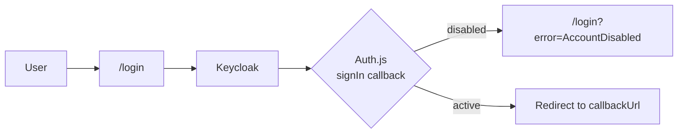

# User management

The admin dashboard lets instance administrators manage user accounts: view all users, see their projects, edit their storage quota, and enable or disable their access.

:::note
This page is only available to administrators. Non-admin users are redirected to `/dashboard`.
:::

## Overview

| Feature            | Description                                                               |
| ------------------ | ------------------------------------------------------------------------- |
| Global stats       | Users (total, active, disabled), projects, total storage, users near quota |
| List users         | Name, email, creation date, last login, project count, quota, storage used and status of each user |
| Sort users         | Click a column header (user, created, last login, projects, usage) to sort |
| View user projects | Click the project count of a user to list their projects, roles and sizes |
| Edit storage quota | Set the quota per user, in MB                                             |
| Disable / enable   | Block or restore a user's access to the editor                            |
| Delete             | Delete a user, transferring or deleting their owned projects              |

The page is available at `/admin` and is linked from the **Admin** button on the main dashboard.

## Statistics

The cards at the top of the page show:

- the number of users, active users and disabled users,
- the total number of projects (`getAdminStats()`),
- the total storage used by all project files, in MB (`getAdminStats()`, this includes projects without owner),
- the number of users using at least 90% of their quota.

## Sorting

Column headers are links that set the `sort` and `dir` query parameters (e.g. `/admin?sort=usage&dir=desc`). Clicking the active column toggles the direction. Sorting is done on the server, after loading the users.

| `sort` value | Sorted by                                  |
| ------------ | ------------------------------------------ |
| `name`       | Name, or email if no name (default)        |
| `created`    | Creation date                              |
| `lastLogin`  | Last login (users who never logged in first in ascending order) |
| `projects`   | Number of projects (any role)              |
| `usage`      | Storage used                               |

## Last login

`User.lastLoginAt` (`DateTime?`, column `last_login_at`) is updated by the Auth.js `signIn` **event** on each successful sign-in through Keycloak. It is `null` (shown as **Never**) for users who haven't signed in since the field was added.

:::note
Sessions use long-lived JWTs refreshed in the background, so this date is the last time the user went through the sign-in flow, not the last time they used the app.
:::

## Access control

Access is checked on two levels:

1. **Page**: `app/admin/page.tsx` redirects to `/login` if there is no valid session, and to `/dashboard` if `session.user.isAdmin` is false.
2. **Server actions**: every action in `lib/actions/admin.ts` calls `requireAdmin()` before touching the database.

:::warning
Server actions are public HTTP endpoints. The check in the page is not enough, which is why each action verifies the caller's role itself.
:::

## User projects

Each row of the users table has a **Projects** column showing how many projects the user is assigned to, whatever their role (`owner`, `editor` or `viewer`).

Clicking the count opens a dialog that lists, for this user:

- the title of each project,
- the user's role on the project,
- the size of the project in MB (sum of the `size` of its files),
- an **Inactive** badge if the project has `isActive` set to `false`.

Details:

- The count comes from `getAllUsers()` (Prisma `_count` on `projectLinks`), so it is loaded with the page.
- The list of projects is loaded **on demand**, each time the dialog is opened, through `getUserProjects(userId)`. This keeps the admin page light and the data up to date.
- The `fileTree` field of projects is never selected, because it can be large.
- The button is disabled when the user has no project.
- The dialog closes with the **✕** button, a click outside, or the `Escape` key.

## Storage quota

- The quota is stored in **bytes** in `User.storageQuota` (`Int`, default `10485760`, i.e. 10 MB).
- The UI displays and edits the value in **MB**.
- Below the quota input, a progress bar shows the storage **used** by the user (`used / quota MB` and percentage). It turns amber from 70% and red from 90%.
- Usage is computed in `getAllUsers()` with the same rule as the quota service: the sum of the `size` of the files of the projects the user **owns** (shared projects do not count).
- The maximum value is `2147483647` bytes (about 2 GiB), the limit of a PostgreSQL `Int`. Higher values are rejected with an `Invalid quota` error.

:::tip
To allow quotas above 2 GiB, change `storageQuota` to `BigInt` in `schema.prisma` and convert the value before passing it to client components.
:::

## Disabling an account

When an admin disables a user:

1. `User.disabled` is set to `true`.
2. Existing sessions are revoked: sessions use JWTs, so the Auth.js `jwt` callback checks `User.disabled` on every request and invalidates the token when the account is disabled.
3. New Socket.io connections are refused for disabled accounts.
4. Any new sign-in attempt is refused by the Auth.js `signIn` callback.

Re-enabling an account only flips the flag back. The user can sign in again right away.

An admin **cannot disable their own account**. The button is disabled in the UI and the action throws an error if called directly.

## Deleting an account

The **Delete** button opens a confirmation dialog. If the user owns projects, the admin chooses between:

- **Transfer** them to another user, who becomes `owner` of each project (their existing assignment is upgraded, or a new one is created). The transfer ignores the new owner's quota; adjust it afterwards if needed.
- **Delete** them permanently, along with their files in the object store.

The admin must type the user's email to confirm. Then, in a single transaction, the projects are transferred or deleted and the `User` row is deleted. Thanks to the cascades in the schema, this also removes their accounts, sessions, project assignments (shared projects), access requests and **comments**.

An admin **cannot delete their own account**.

:::note
The Keycloak account is not touched. If the person signs in again, a new, empty user is created. Disable the account instead if you want to block access.
:::

## Sign-in flow for disabled users

The login page redirects automatically to Keycloak when there is no error. When `error` is present, it shows a message instead, to avoid an infinite redirect loop.

| `error` value     | Message shown                    | Retry button |
| ----------------- | -------------------------------- | ------------ |
| `AccountDisabled` | Account disabled                 | No           |
| `AccessDenied`    | Access denied                    | Yes          |
| any other value   | Generic "Sign-in failed" message | Yes          |

:::note
If the user still has an active Keycloak session, a retry signs them in again silently and the callback refuses them again. This is expected.
:::

## Server actions

All actions live in `lib/actions/admin.ts`.

| Action                           | Description                                                                | Errors                                      |
| -------------------------------- | -------------------------------------------------------------------------- | ------------------------------------------- |
| `getAllUsers()`                  | Returns all users (id, name, email, status, quota, storage used, owned project count, dates, project count) | Not an admin                                |
| `getAdminStats()`                | Returns the total number of projects and total storage used                | Not an admin                                |
| `getUserProjects(userId)`        | Returns the projects of a user (id, title, `isActive`, size) with their role | Not an admin                              |
| `setUserDisabled(userId, state)` | Enables or disables a user and revokes sessions                            | Not an admin, user not found, self-disable  |
| `updateUserQuota(userId, bytes)` | Updates the storage quota                                                  | Not an admin, user not found, invalid quota |
| `deleteUser(userId, transferToUserId \| null)` | Deletes a user, transferring (or deleting if `null`) their owned projects | Not an admin, user not found, self-delete, transfer to the same user |

All mutating actions call `revalidatePath("/admin")` so the list refreshes without a manual reload.

## Components

| File                            | Role                                                                          |
| ------------------------------- | ----------------------------------------------------------------------------- |
| `app/admin/page.tsx`            | Server component: auth check, data loading, stats, table                      |
| `components/Admin/user-row.tsx` | Client component: projects dialog, quota input, save, enable/disable, delete  |
| `components/Admin/delete-user-dialog.tsx` | Client component: delete confirmation, transfer or deletion of owned projects |
| `app/login/page.tsx`            | Login redirect and error display                                              |
