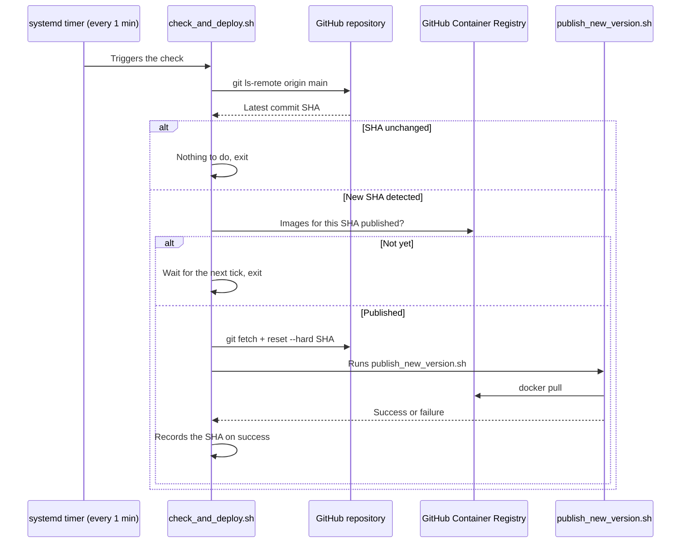

# Automatic Deployment

This document describes the automatic deployment mechanism for **tisc-editor** on the production LXC. The system watches the `main` branch of the repository and automatically runs `publish_new_version.sh` whenever a new commit is detected.

## Why this approach

The LXC is not reachable from GitHub Actions (no inbound connection is possible). Rather than pushing a deployment from CI, the LXC **periodically polls** the remote repository to check whether `main` has changed. If it has, it pulls the new code and runs the publish script.

The Docker images are **built by GitHub Actions**, not on the LXC: building Next.js and Docusaurus used all the CPU of the server and most of its RAM for several minutes, while the app was running. The [Publish images](./devops/ci.md#publish-images) workflow pushes them to GHCR, tagged with the commit SHA, and the LXC only pulls them.

## How it works



1. A **systemd timer** triggers `check_and_deploy.sh` every minute.
2. The script compares the remote SHA of `main` (`git ls-remote`) with the last deployed SHA, stored in `/var/lib/tisc-editor/last_deployed_sha`.
3. If nothing has changed, the script exits immediately (no unnecessary load).
4. If a new commit is detected:
   - The script checks (`docker manifest inspect`) that the app and docs images of this commit are published on GHCR. If not (the workflow is still running, or it failed), it exits and checks again on the next tick. The wait is logged once per commit.
   - `git fetch` + `git reset --hard <SHA>` pulls the code of this exact commit.
   - `publish_new_version.sh` is executed with `IMAGE_TAG=<SHA>` and pulls the images.
   - On success, the new SHA is recorded as the "last deployed" one.
   - On failure, the SHA is **not** recorded, so the deployment is automatically retried on the next tick.
5. A lock file (`flock`) prevents two runs from overlapping if a deployment takes longer than a minute.

:::info
Because the script runs without `--db`, an automatic deployment only redeploys the app, the docs and nginx. The PostgreSQL (`tisc-db`) and Garage (`tisc-garage`) containers are never restarted by the automatic mechanism, so the database and the object storage are not interrupted.
:::

## File locations

| File | Purpose |
|---|---|
| `/root/tisc-editor/scripts/check_and_deploy.sh` | Main check/deploy script |
| `/etc/systemd/system/tisc-deploy-check.service` | systemd unit running the script |
| `/etc/systemd/system/tisc-deploy-check.timer` | systemd timer triggering the service every minute |
| `/var/lib/tisc-editor/last_deployed_sha` | State: SHA of the last successful deployment |
| `/var/lib/tisc-editor/waiting_images_sha` | State: SHA whose images are being waited for (avoids logging every minute) |
| `/var/lock/tisc-editor-deploy.lock` | Anti-overlap lock |

## Installation on the LXC

```bash
# Create the state directory
mkdir -p /var/lib/tisc-editor

# Install the systemd units
cp /root/tisc-editor/scripts/tisc-deploy-check.service /etc/systemd/system/
cp /root/tisc-editor/scripts/tisc-deploy-check.timer /etc/systemd/system/

# Reload systemd and enable the timer
systemctl daemon-reload
systemctl enable --now tisc-deploy-check.timer
```

:::warning
Before enabling the timer on a fresh server, make sure the GHCR packages are public (see [Production Deployment](./deployment.md)), then run `./scripts/publish_new_version.sh --db` manually once and complete the **First-time Garage setup** described in the [Production Deployment](./deployment.md) page. The automatic deployment does not start the database or Garage, and the app needs both to be running.
:::

## Checking that it's running

```bash
# See the next scheduled run
systemctl list-timers tisc-deploy-check.timer

# Trigger an immediate manual check
systemctl start tisc-deploy-check.service

# Follow the logs live
journalctl -t tisc-deploy -f
```

## Forcing a redeploy

To force a redeploy even if the code hasn't changed (for example after a manual change on the server), simply delete the state file before re-running the check:

```bash
rm /var/lib/tisc-editor/last_deployed_sha
systemctl start tisc-deploy-check.service
```

## Known limitations

- Deployment starts up to a minute after the **Publish images** workflow finishes (a few minutes after the push), since it waits for the timer to fire.
- If the **Publish images** workflow fails, the commit is never deployed: the server keeps running the previous version. Fix the build and push again (or re-run the workflow).
- A failure in `publish_new_version.sh` is automatically retried on every tick until the underlying issue is fixed — keep an eye on the logs if you see repeated failures.
- The `.env` file and `garage/garage.toml` changes are not part of the automatic flow for the running Garage container: if you change `garage.toml` or `GARAGE_RPC_SECRET`, run `./scripts/publish_new_version.sh --db` manually. If a new version requires new variables in `.env` (for example new `S3_*` values), add them on the server **before** pushing, since `.env` is not versioned and a missing variable makes the deployment fail and retry every minute.
