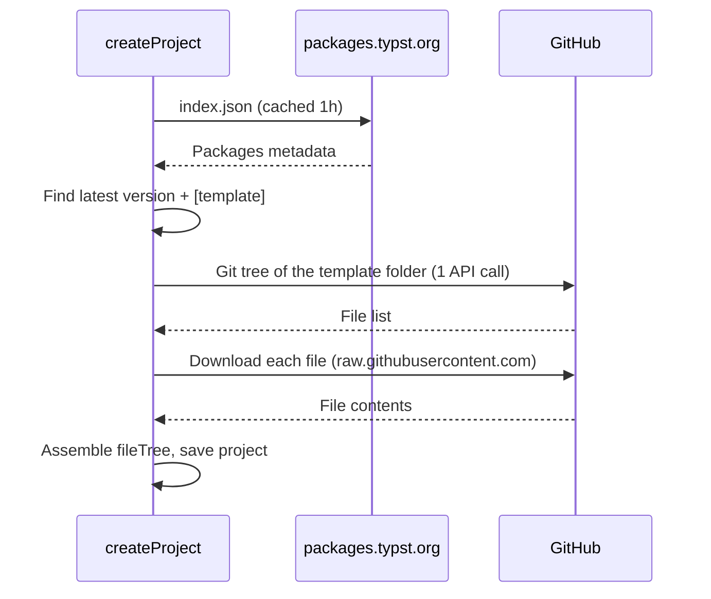

# Templates Management

Every template published on [Typst Universe](https://typst.app/universe/search/?kind=templates) can be used to create a project (see the [template picker](../../tutorial/projects/create#templates)). Nothing is hard-coded: templates are read from the Typst Universe index and downloaded from GitHub at project creation time. The code lives in `lib/typst-universe.ts`.

## Typst Universe index

Typst Universe publishes the metadata of every package version at [`https://packages.typst.org/preview/index.json`](https://packages.typst.org/preview/index.json). Each entry is the content of the package's `typst.toml`, including its `[template]` section:

```toml
[template]
path = "src"                          # folder copied into the project
entrypoint = "report.typ"             # main file, relative to path
thumbnail = "report_thumb.png"        # preview image, relative to the package root
```

The index (~2.5MB) is downloaded on the server, reduced to the **latest version of each package that has a `[template]` section**, and kept **in memory for one hour** (it is too large for the Next.js data cache). If a refresh fails, the previous index keeps being served.

## Favorites and search

Both are server actions in `lib/actions/templates.ts` and require an authenticated user:

| Action | Description |
| --- | --- |
| `getFavoriteTemplates()` | Templates whose name starts with `isc-hei-` (`FAVORITE_PREFIX`), sorted by name. Shown by default. |
| `searchTemplates(query)` | Searches the name, keywords and description. Every word of the query must match; matches on the name rank first, then the most recently updated. Returns at most **10** results (`MAX_SEARCH_RESULTS`). |

Only display data is sent to the client: name, version, description, authors, whether there is a thumbnail, and the Typst Universe page URL (`https://typst.app/universe/package/<name>`, opened by the info icon).

Thumbnails are served by [`GET /api/templates/[name]/thumbnail`](./api-endpoints#get-apitemplatesnamethumbnail), which downloads the image declared in `typst.toml`, resizes it and converts it to WebP.

:::info[Adding a favorite]

Any package published on Typst Universe with a name starting with `isc-hei-` and a `[template]` section shows up in the favorites automatically.

:::

## How a template is imported

The client only sends the package **name** (`template` form field, or `blank`). In `createProject`:

1. **Resolve the template** — `findTemplate(name)` looks the package up in the index. The version, folder, entrypoint and thumbnail always come from the index, never from the client. An unknown package is rejected.
2. **List the files** — `importTemplateAsTree` makes a **single** GitHub API call to the Git trees API (`/repos/typst/packages/git/trees/main:packages/preview/<name>/<version>/<path>?recursive=1`).
3. **Download the files** — each file is downloaded from `raw.githubusercontent.com` (8 at a time), which does not count against the GitHub API rate limit.
4. **Set the main file** — the entrypoint is marked as the main file (`isMain: true`). If it sits at the root of the template folder, it is renamed to `main.typ` (unless another `main.typ` already exists); otherwise it stays where it is, so relative imports keep working.

The `blank` template does not go through Typst Universe at all and simply creates a project with an empty `main.typ`.



Templates usually import their own package (e.g. `#import "@preview/isc-hei-report:0.8.1": *`); the compiler downloads it from Typst Universe when compiling.

## Filtering and limits

While building the tree, the following files are skipped:

- Hidden files/folders (names starting with `.`)
- `.md` files
- `LICENSE`

Paths coming from the index and from GitHub are validated (no absolute paths, no `..`). A template is rejected if it has more than **300 files** or weighs more than **30MB**.

## Rate limiting

Only listing the template's files uses the GitHub REST API (one request per project creation). Without a configured `GITHUB_TOKEN`, it is limited to 60 requests/hour per IP — see [Configuration](../configuration#github) for setting up a token.

## Quota enforcement

Before the project is actually created, the size of the generated `fileTree` is checked against the user's storage quota (`checkUserQuota`), the same mechanism used by [`/api/projects/save`](./api-endpoints#post-apiprojectssave). If the quota would be exceeded, project creation is aborted before any database write happens.
